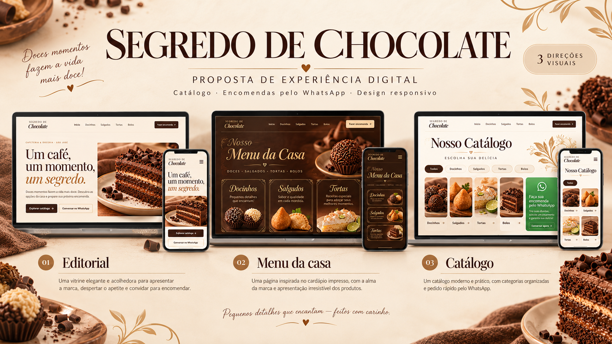

# Segredo de Chocolate

Protótipo de uma página de apresentação e catálogo com três direções alternáveis:

1. **Editorial** — hero fotográfico, navegação por categorias e cartões de produtos.
2. **Menu da casa** — composição de cardápio impresso em campo de cacau, com duas colunas.
3. **Catálogo** — busca, filtros e lista de interesses para iniciar uma consulta no WhatsApp.

## Executar localmente

Abra `index.html` no navegador ou sirva esta pasta com qualquer servidor estático. O protótipo não precisa de dependências de build.

## Publicação

O site é estático e pode ser publicado pelo GitHub Pages. Os preços e as informações do catálogo foram transcritos dos cardápios recebidos. Disponibilidade, prazo, tamanhos e combinações devem ser confirmados pelo WhatsApp.

## Contatos exibidos

- WhatsApp: (12) 99792-5603
- Instagram: @segredodechocolate
- Endereço informado: Rua Canopus, 622 — São José
- Chave Pix conforme o cardápio: (12) 988013592

As imagens de produto foram geradas para o protótipo; não são fotos fornecidas pela loja.
